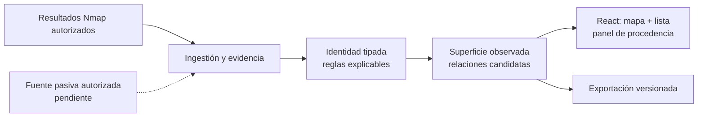

# CHEF

**Evidencia clara para entender una superficie de ataque autorizada.**

CHEF es un proyecto del **Centro Cultural de Ciberseguridad**. Su objetivo es reducir el trabajo manual de reconocimiento: reunir resultados activos y señales pasivas, quitar duplicados sin perder procedencia y mostrar **por qué** dos observaciones se relacionan. Un servicio abierto es una observación; una relación entre fuentes puede ser una inferencia; ninguno de los dos es por sí mismo una vulnerabilidad confirmada.

La dirección vigente es **CHEF Web**: una interfaz React/Vite/TypeScript en navegador y un backend objetivo en Rust. La decisión está en el [ADR 0013](docs/adr/0013-producto-web.md), que sustituye el destino de escritorio del [ADR 0012](docs/adr/0012-escritorio-tauri-rust.md). **Estado real:** la página web actual muestra el fixture offline y sus relaciones; todavía no existe una API HTTP Rust conectada a ella, ni autenticación o proyectos multiusuario. El código Tauri y su persistencia local se conservan durante la transición, pero no son el destino vigente. No se afirma que haya escaneo activo o flujo de red en vivo.

## Estado verificable

- **Funciona hoy:** núcleo TypeScript con dominio aislado, importador Nmap XML offline, scope literal, identidad determinista, deduplicación conservadora, relaciones con evidencia y exportación `Snapshot 1.0.0` mediante CLI. Los tests incluyen un control negativo que impide fusionar hosts por hostname compartido y entradas XML hostiles.
- **Spike separado:** adaptador Java/Montoya para normalizar requests HTTP seleccionadas. Compila y tiene pruebas de conformidad, pero aún requiere validación manual dentro de Burp y no correlaciona HTTP con Nmap.
- **Implementado:** core/CLI TypeScript offline con importación Nmap acotada, IDs deterministas, evidencia, `Snapshot 1.0.0` y control negativo; explorador React/Vite local con fixture, lista, panel de evidencia y pruebas.
- **Portado parcialmente:** `packages/rust-core` procesa Nmap, eventos JSONL y varias respuestas archivadas offline; aplica límites y scope donde corresponde, conserva procedencia y produce snapshots versionados. `chef-application` usa workers Tokio para mover parseo síncrono fuera del hilo asíncrono, con canal acotado y cancelación cooperativa.
- **Implementación heredada:** Tauri compone importación local, acceso a SurrealDB/RocksDB y comandos del explorador. Las importaciones de Censys y urlscan se guardan en `provider_imports`, separadas de Snapshot, con hash, ID determinista y linaje. Este flujo no está conectado al cliente web; la API Rust para navegador, autenticación, separación de proyectos y almacenamiento compartido siguen pendientes.
- **Pendiente:** completar las capacidades de reconocimiento compatibles con CHEF y su composición. Rust adapta eventos de evidencia a activos CHEF tipados con evidencia y relaciones; `DnsQueryPlan` y `ExecuteDnsPlan` planifican y coordinan consultas con autorización por solicitud, conservando resultados parciales. El caso de uso y el adaptador Hickory siguen sin conexión a Tauri; la app no lanza consultas. Wildcards, concurrencia por lotes, promoción de scope, deduplicación de hijos y control runaway siguen pendientes. La demo inicial usa exclusivamente fixtures offline.

CHEF **no lanza escaneos en esta etapa**: el navegador usa fixtures y los logs son simulados. Consultas pasivas, sincronización remota y escaneo activo requieren permisos, límites y confirmación. La transición a API Rust y el despliegue web aún no están validados.

## Probar el incremento actual

Requiere Node.js 24 LTS, npm y Rust estable con Cargo/rustfmt/clippy. Los fixtures son sintéticos, usan loopback y no necesitan Nmap, Burp, base de datos ni actividad de red.

```sh
npm ci
npm run check
npm run demo
```

`npm run check` verifica TypeScript, core Rust, almacenamiento, contratos, pruebas y build web. GitHub Actions añade pruebas de `chef-application` y compilación Tauri con WebKitGTK/RocksDB. El build del instalador Windows y su prueba manual se registran por separado.

Para generar un snapshot JSON con la CLI:

```sh
npm run build
node dist/apps/cli/src/main.js fixtures/nmap/lab.xml fixtures/scope/lab.json > chef.json
```

El JSON generado puede contener datos sensibles si se usa evidencia real: no se debe subir al repositorio. El comando lee archivos locales; no dirige tráfico al objetivo. El [contrato versionado](docs/contracts/README.md) documenta campos y semántica.

## Diseño del producto



La idea diferencial es una **hipótesis comprobable**: un analista debería encontrar y explicar un servicio y su relación con una señal pasiva con menos pasos y tiempo que revisando fuentes por separado, sin aumentar falsos enlaces ni perder evidencia. La [investigación de fuentes y algoritmos](docs/research/recon-correlation-2026-09.md) y la [selección de OSINT abierta](docs/research/open-osint-selection.md) comparan opciones, límites temporales y cómo se medirá. “Tiempo real” requerirá latencia, frescura y fallos de actualización medidos; el incremento actual solo se actualiza por ejecución.

## Navegar el repositorio

- [Dirección web vigente (ADR 0013)](docs/adr/0013-producto-web.md) · [alcance](docs/product/scope.md) · [PRD heredado de escritorio](docs/product/desktop-prd.md)
- [C4 del dominio](docs/architecture/overview.md) · [arquitectura local heredada](docs/architecture/desktop-tauri.md) · [ADR 0012 histórico](docs/adr/0012-escritorio-tauri-rust.md)
- [Investigación](docs/research/recon-correlation-2026-09.md) · [OSINT abierta](docs/research/open-osint-selection.md) · [fuentes primarias fechadas](docs/research/sources.json)
- [Scrum de transición al 31-10](docs/plan/scrum-actual.md) · [backlog local heredado](docs/plan/backlog-desktop.md) · [backlog web previo](docs/plan/backlog.md)
- [Contribuir y revisar PRs](CONTRIBUTING.md) · [CI y CodeQL](docs/governance/ci-security.md) · [índice documental](docs/README.md) · [skills locales](docs/process/skills-usage.md)

El dominio y los casos de uso CHEF viven en `packages/domain` y `packages/rust-core`; `packages/rust-storage` y `apps/desktop/src-tauri` pertenecen a la implementación local heredada. `apps/web` es la interfaz vigente, todavía servida con un cliente de fixture; `apps/cli` conserva la referencia offline TypeScript. `extensions/burp` contiene un spike separado. Las reglas del equipo están en [AGENTS.md](AGENTS.md).

CHEF se distribuye bajo [AGPL-3.0](LICENSE); la [atribución y las licencias de dependencias](docs/governance/licenses.md) describen sus componentes de terceros. CHEF no está afiliado ni aprobado por PortSwigger o Nmap. Solo se trabaja con datos y entornos autorizados; un archivo importado nunca amplía el scope.

## Referencia del formato de importación

El importador procesa localmente archivos JSONL ya generados; no ejecuta descubrimiento ni concede autorización de red. Para consultar el formato de origen y las capacidades adaptadas, véanse la [referencia upstream de BBOT](https://github.com/blacklanternsecurity/bbot), la [auditoría de capacidades](docs/migration/auditoria-fuente.md), el [inventario](docs/migration/inventario-migracion.csv), el [plan de portado a Rust](docs/migration/plan-migracion-rust.md) y los [contratos CHEF](docs/contracts/README.md).
