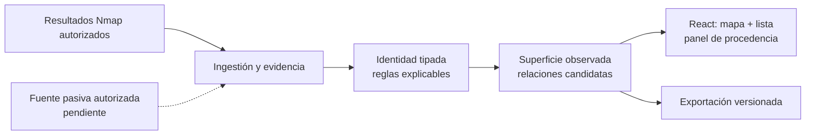

# CHEF

**Evidencia clara para entender una superficie de ataque autorizada.**

CHEF es un proyecto del **Centro Cultural de Ciberseguridad**. Su objetivo es reducir el trabajo manual de reconocimiento: reunir resultados activos y señales pasivas, quitar duplicados sin perder procedencia y mostrar **por qué** dos observaciones se relacionan. Un servicio abierto es una observación; una relación entre fuentes puede ser una inferencia; ninguno de los dos es por sí mismo una vulnerabilidad confirmada.

La dirección vigente es una aplicación local de escritorio: React/Vite/TypeScript, Tailwind y shadcn/ui en frontend; Tauri v2 con núcleo Rust asíncrono; SurrealDB embebida con RocksDB para persistencia y grafo; xterm.js para logs simulados; y exportación DefectDojo opcional y explícita. La decisión está en el [ADR 0012](docs/adr/0012-escritorio-tauri-rust.md) y el [diseño de persistencia](docs/architecture/persistencia-local.md). **El código actual sigue en migración:** existe un shell Tauri conectado al importador offline y al almacén SurrealDB, además del núcleo/CLI TypeScript y explorador React/Vite que sirven como referencia de conformidad. Faltan capacidades del catálogo, integración y validación manual del ciclo de vida de persistencia. Burp queda como línea posterior.

## Estado verificable

- **Funciona hoy:** núcleo TypeScript con dominio aislado, importador Nmap XML offline, scope literal, identidad determinista, deduplicación conservadora, relaciones con evidencia y exportación `Snapshot 1.0.0` mediante CLI. Los tests incluyen un control negativo que impide fusionar hosts por hostname compartido y entradas XML hostiles.
- **Spike separado:** adaptador Java/Montoya para normalizar requests HTTP seleccionadas. Compila y tiene pruebas de conformidad, pero aún requiere validación manual dentro de Burp y no correlaciona HTTP con Nmap.
- **Implementado:** core/CLI TypeScript offline con importación Nmap acotada, IDs deterministas, evidencia, `Snapshot 1.0.0` y control negativo; explorador React/Vite local con fixture, lista, panel de evidencia y pruebas.
- **Portado parcialmente:** `packages/rust-core` procesa Nmap y eventos JSONL de evidencia offline, aplica scope, conserva procedencia y produce snapshots 1.0/1.1. Un coordinador Tokio ejecuta estas importaciones en workers bloqueantes, ofrece cancelación cooperativa y comunica estados por un canal acotado; hay nueve pruebas Rust.
- **Parcial:** `packages/rust-storage` abre SurrealDB embebida sobre RocksDB y persiste snapshots versionados por `runId`; Tauri ya integra importación, consulta del grafo y exportación local. Quedan pendientes la proyección normalizada, recuperación/backups multiplataforma y validación manual del flujo WebView.
- **Pendiente:** completar las capacidades de reconocimiento compatibles con CHEF y sus adaptadores. Rust adapta eventos de evidencia a activos CHEF tipados con evidencia y relaciones; el motor recursivo admite módulos offline registrados, pero no incluye resolutores DNS/HTTP ni fuentes pasivas activas. La demo inicial usa exclusivamente fixtures offline.

La demo objetivo sigue siendo el **31 de octubre de 2026**. El [plan Scrum vigente](docs/plan/scrum-actual.md) asigna la primera vertical de escritorio offline a César, Diego y Jhojan. CHEF **no lanza escaneos en esta etapa**: los logs representan una simulación con fixtures. Consultas pasivas, sincronización remota y escaneo activo no se habilitan sin permiso, límites y confirmación del usuario.

## Probar el incremento actual

Requiere Node.js 24 LTS, npm y Rust estable con Cargo/rustfmt/clippy. Los fixtures son sintéticos, usan loopback y no necesitan Nmap, Burp, base de datos ni actividad de red.

```sh
npm ci
npm run check
npm run demo
```

`npm run check` verifica TypeScript, Rust, almacenamiento, contratos, pruebas y build web. Los crates Rust pueden ejecutarse por separado con `npm run rust:check`.

Para generar un snapshot JSON con la CLI:

```sh
npm run build
node dist/apps/cli/src/main.js fixtures/nmap/lab.xml fixtures/scope/lab.json > chef.json
```

El JSON generado puede contener datos sensibles si se usa evidencia real: no se debe subir al repositorio. El comando lee archivos locales; no dirige tráfico al objetivo. El [contrato versionado](docs/contracts/README.md) documenta campos y semántica.

## Diseño del producto



La idea diferencial es una **hipótesis comprobable**: un analista debería encontrar y explicar un servicio y su relación con una señal pasiva con menos pasos y tiempo que revisando fuentes por separado, sin aumentar falsos enlaces ni perder evidencia. La [investigación de fuentes y algoritmos](docs/research/recon-correlation-2026-09.md) y la [selección de OSINT abierta](docs/research/open-osint-selection.md) comparan opciones, límites temporales y cómo se medirá. “Tiempo real” requerirá latencia, frescura y fallos de actualización medidos; el incremento actual solo se actualiza por ejecución.

## Navegar el repositorio

- [PRD de escritorio](docs/product/desktop-prd.md) · [requisitos de escritorio](docs/product/desktop-requirements.md) · [alcance](docs/product/scope.md)
- [Arquitectura actual](docs/architecture/overview.md) · [arquitectura Tauri/Rust propuesta](docs/architecture/desktop-tauri.md) · [ADR 0012](docs/adr/0012-escritorio-tauri-rust.md)
- [Investigación](docs/research/recon-correlation-2026-09.md) · [OSINT abierta](docs/research/open-osint-selection.md) · [fuentes primarias fechadas](docs/research/sources.json)
- [Scrum vigente hasta el 31-10](docs/plan/scrum-actual.md) · [backlog de migración](docs/plan/backlog-desktop.md) · [backlog web anterior](docs/plan/backlog.md)
- [Contribuir y revisar PRs](CONTRIBUTING.md) · [CI y CodeQL](docs/governance/ci-security.md) · [índice documental](docs/README.md) · [skills locales](docs/process/skills-usage.md)

El dominio y los casos de uso CHEF viven en `packages/domain` y `packages/rust-core`; `packages/rust-storage` gestiona la persistencia y `apps/desktop/src-tauri` compone el flujo local con React. `apps/cli` conserva la referencia offline TypeScript. `extensions/burp` contiene un spike separado. Las reglas del equipo están en [AGENTS.md](AGENTS.md).

CHEF se distribuye bajo [AGPL-3.0](LICENSE); la [atribución y las licencias de dependencias](docs/governance/licenses.md) describen sus componentes de terceros. CHEF no está afiliado ni aprobado por PortSwigger o Nmap. Solo se trabaja con datos y entornos autorizados; un archivo importado nunca amplía el scope.

## Referencia del formato de importación

El importador procesa localmente archivos JSONL ya generados; no ejecuta descubrimiento ni concede autorización de red. Para consultar el formato de origen y las capacidades adaptadas, véanse la [referencia upstream de BBOT](https://github.com/blacklanternsecurity/bbot), la [auditoría de capacidades](docs/migration/auditoria-fuente.md), el [inventario](docs/migration/inventario-migracion.csv), el [plan de portado a Rust](docs/migration/plan-migracion-rust.md) y los [contratos CHEF](docs/contracts/README.md).
