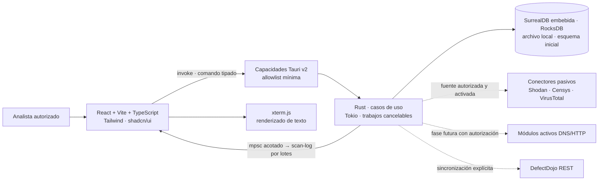
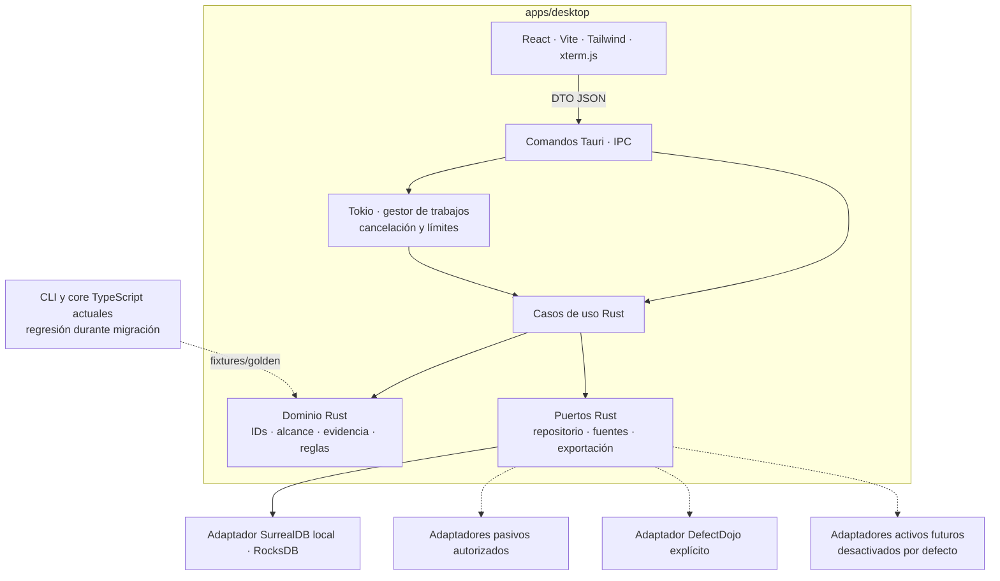

# Arquitectura propuesta de escritorio: Tauri y Rust

Actualizado 18-10-2026. **Dirección aceptada: escritorio Tauri/Rust con SurrealDB embebida.** Implementado parcialmente: shell Tauri v2, importación offline del fixture o de un JSONL de origen seleccionado por el usuario junto con una política CHEF de scope, persistencia en SurrealDB/RocksDB, grafo y descarga JSON. Los trabajos Tokio emiten `scan-log` estructurado durante el procesamiento; React valida contratos y los presenta en texto con xterm.js y transcripción accesible. `cargo check`, `cargo build --locked` y los bundles MSI/NSIS de Tauri pasan con toolchain nativo local; las rutas de salida están en `apps/desktop/src-tauri/target/release/bundle`. Falta completar módulos y validar recuperación/arranque en WebView. El [ADR 0012](../adr/0012-escritorio-tauri-rust.md) registra la decisión y sus gates.

## Corte implementado

`apps/desktop/src-tauri` compone el núcleo y el adaptador de almacenamiento. La ventana solo tiene el permiso `core:default`; `load_offline_demo_snapshot` consume datos sintéticos loopback y el comando de importación JSONL recibe texto JSONL acotado y una `ScopePolicy` explícita. Ambos cargan la configuración local acotada, usan el parser Rust y guardan snapshot, eventos fuente/derivados y proyección CHEF en el directorio local que entrega Tauri. Las ramas CHEF de transformación offline requieren activación explícita en `config.toml` y vienen apagadas por defecto. Este flujo no ejecuta módulos de red ni convierte el scope importado en autorización de tráfico.

La importación de fixture y JSONL local, el scope explícito y la terminal local están conectados. Proveedores pasivos, descubrimiento activo y DefectDojo siguen propuestos y no están disponibles.

El crate `packages/rust-application` define `DnsQueryPlan`: para una IP planifica PTR; para un nombre planifica A/AAAA/CNAME primero y SRV/MX/NS/SOA/TXT después solo cuando el modo no es mínimo y la distancia del objetivo está bajo el límite de búsqueda. `ExecuteDnsPlan` recorre las consultas en orden, vuelve a exigir autorización para cada una, conserva resultados parciales y se detiene ante cancelación, revocación, autorización inválida o expiración. `ResolveDns` aplica límites de respuesta y clasifica resultados que podrían alimentar seguimiento frente a evidencia que solo debe conservarse. `DnsWildcardAssessment` compara resultados DNS ya entregados con muestras por zona/tipo y retorna clasificaciones trazables más una sugerencia de nombre; no genera consultas ni muta activos. `packages/adapters/rust` implementa el puerto con Hickory, upstreams configurados por IP literal y timeout acotado; desactiva la configuración DNS del sistema y lectura del archivo hosts. `DnsAuthorizationRegistry` almacena concesiones efímeras por objetivo exacto, tipos de registro, cuota de intentos y expiración; un intento cuenta aunque falle o se cancele. Revocarlas detiene las consultas en curso y las respuestas solo quedan como evidencia. La aplicación que registre una concesión debe comprobar consentimiento y scope vigente. Estos componentes aún no están compuestos por Tauri: no se expone un comando de escaneo ni se ejecutan consultas desde la aplicación. El flujo de importación y demo sigue offline.

La registry no verifica por sí misma consentimiento, pertenencia del objetivo al scope, ni que el digest recibido corresponda a la política autorizada; tampoco vincula todavía una concesión con proyecto/ejecución. Es una frontera de control incompleta y no se debe componer en un comando activo hasta añadir esa verificación y asociación en la capa de aplicación.

## Contexto y límites de confianza

La interfaz webview es una frontera no confiable. No accede directamente a disco, base, shell, red de reconocimiento ni secretos. Rust valida el comando, su tamaño, alcance, proyecto/almacén y estado antes de ejecutar un caso de uso. Las capacidades Tauri limitan qué comandos están disponibles a la ventana principal; el código vuelve a validar cada dato porque la configuración de permisos por sí sola no aplica reglas de dominio.

La base de datos se abre una sola vez en Rust bajo el directorio de datos de la aplicación que devuelve Tauri. No se codifica una ruta `~/.config` fija: las rutas y permisos cambian entre Windows, macOS y Linux. El frontend accede a ella solo a través de casos de uso y DTO.

## Componentes y dependencias

El dominio Rust no depende de Tauri, filesystem, SurrealDB, React ni proveedores. Los casos de uso dependen de puertos; adaptadores y composición viven en la aplicación de escritorio. La capa de aplicación comprueba autorización y alcance. La UI representa contratos y no reimplementa identidad, fusión ni deduplicación.

## IPC, trabajo asíncrono y terminal

El frontend llama comandos como `start_demo_job`, `cancel_job`, `import_snapshot`, `list_assets` y `get_evidence`. Los comandos reciben structs serializables con campos y límites explícitos. `start_demo_job` valida el request y devuelve `jobId` sin esperar a que termine. Tokio procesa el trabajo en segundo plano; un canal `mpsc` con capacidad acotada evita crecer sin límite si el webview consume lento.

Los logs usan el DTO interno `scan-log 1.2.0`: `schemaVersion`, `jobId`, `requestId`, `sequence`, `phase`, mensaje fijo y, para registros de evidencia, `eventType` y `observedAt`. Rust nunca incluye host, URL ni carga de evidencia. En la importación JSONL, el parser valida el documento completo y su linaje antes de publicar datos; después, el motor llama un observador conforme acepta cada evento y expande las reglas offline. El worker publica con `try_send` en un canal Tokio acotado; si está lleno reintenta desde el hilo bloqueante, aplica backpressure y comprueba cancelación en cada espera. La UI valida cada mensaje, presenta texto y mantiene una transcripción accesible; limpia la suscripción `listen()` al desmontarse. La importación Nmap y el parseo NDJSON inicial aún materializan su entrada antes de emitir actividad. Este flujo procesa evidencia importada: no equivale a un ciclo de escaneo BBOT ni inicia consultas DNS/HTTP. `HttpRequestPlan` prepara candidatos GET offline desde URLs y puertos observados. `ExecuteHttpPlan` exige autorización y un transporte que conecte solo a IP aprobadas; `HttpAuthorizationRegistry` ofrece concesiones efímeras revocables y `ReqwestHttpTransport` no sigue redirects, usa proxies ni reintenta automáticamente y reporta el peer conectado. La aplicación que crea una concesión debe validar consentimiento, scope escrito y resolución DNS vigente. Ningún adaptador está compuesto en Tauri/IPC; el ejecutor no se ha invocado. El agrupamiento visual y la cancelación desde la UI siguen pendientes antes de habilitar volúmenes mayores.

Los eventos de Tauri son asíncronos y su sistema no ofrece seguridad de tipos en compilación. Por eso el payload tiene versión, esquema y validador de runtime TypeScript. Para flujos de salida de alto volumen, se medirá la necesidad de lotes o un canal dedicado. Xterm.js es una vista de salida; no expone una shell interactiva.

`ImportEventRateCounter` mide el procesamiento offline con tiempo monotónico, una ventana móvil predeterminada de 60 segundos y muestras acotadas. El worker adjunta el snapshot a los eventos aceptados y Tauri resume la actividad cada 100 eventos mediante el mensaje existente `scan-log 1.2.0`; xterm.js lo presenta sin añadir campos al contrato. Si el límite de muestras recorta datos vigentes, el resumen indica que es un límite inferior. No usa timestamps importados ni se interpreta como velocidad de reconocimiento de red. Las métricas por módulo en vivo siguen pendientes.

El simulador offline usa exclusivamente fixtures, muestra “Simulación” en la UI y no resuelve DNS, abre sockets ni consulta proveedores. Una futura tarea activa requerirá aprobación escrita del objetivo, allowlist resuelta, protocolo/puertos, cuotas, cancelación comprobada, registro de auditoría y entorno de laboratorio. Un botón de interfaz no equivale a autorización.

## Persistencia local y grafo

SurrealDB embebida con RocksDB es la base elegida para el escritorio; no requiere un servicio externo y permite persistir documentos y relaciones del grafo en el mismo almacén local. El adaptador Rust guarda el snapshot completo, los eventos de origen originales ya saneados y la adaptación CHEF tipada (activos, evidencias, relaciones y tipos no mapeados) en un registro por `runId`. Todavía faltan consultas de producto e índices. Los IDs persistidos se derivan de los IDs CHEF deterministas; nunca usar IDs aleatorios de la base como identidad de producto. Una consulta del grafo no convierte una relación en evidencia por sí misma.

La capa de aplicación añade `ListImportRuns` y el puerto `ImportHistoryPort`; `chef-storage` implementa la consulta paginada de hasta 100 resúmenes, valida versión e identidad `runId` y no carga los grafos completos. La composición del comando Tauri y el panel para seleccionar una importación siguen pendientes. El concepto actual es historial de ejecuciones/importaciones, no CRUD de proyectos.

El adaptador SurrealDB debe verificar apertura/reapertura, recuperación, escrituras atómicas, concurrencia, backup/restauración, compatibilidad de esquema y tamaño del paquete por plataforma. Cada prueba usa directorio temporal exclusivo. La ruta y el esquema interno no forman parte del contrato público. El uso de vectores queda propuesto hasta definir una tarea de similitud, embeddings locales/remotos, retención y evaluación medible.

La importación y escritura son atómicas: primero validar snapshot, referencias e invariantes; luego una transacción local o estrategia equivalente con recuperación; por último marcar la ejecución completa. Si el motor embebido no ofrece la semántica necesaria, no publicar una importación parcial como válida. El XML original no se guarda por defecto; la política local define retención, borrado, permisos de archivo y backup antes de almacenar evidencia real.

## Configuración, fuentes y exportación

`load_chef_config` lee `config.toml` opcional desde el directorio de configuración que entrega Tauri, con lectura limitada a 64 KiB y parseo TOML en un worker. Las capas se fusionan y validan en el core antes de que React reciba el DTO versionado. No se copian configuraciones externas ni archivos de secretos; la configuración CHEF no admite claves API ni tokens y el archivo ausente usa defaults tipados sin escribir en disco. El almacén de secretos del sistema operativo será un puerto separado si se aprueban conectores.

El comando `parse_chef_target_seed` ofrece clasificación local de IP, CIDR, DNS, URL HTTP(S), endpoint TCP, ASN, organización y semillas de contexto (correo, usuario, ruta, app móvil y patrón). React lo invoca bajo demanda y valida `target-seed 1.3.0`; el resultado no modifica `config.toml` ni `ScopePolicy`, y no accede a filesystem/red ni activa el motor de reconocimiento.

Las transformaciones offline disponibles se activan en `[modules]`; por omisión todas están deshabilitadas. El perfil `offline_hints` activa derivaciones locales: Rust añade eventos `DNS_NAME_HINT` y `URL_HINT` con procedencia, la proyección conserva la calificación `hint`, SurrealDB guarda el grafo y React lo muestra junto a su evidencia fuente. `chef_cloud_storage_hints` reconoce convenciones S3/GCS y `chef_bimi_url_hints` extrae URI HTTPS de `l=`/`a=` en registros BIMI TXT ya importados. Estas URL son candidatas; no se visitan, descargan ni validan. Ninguna regla crea observaciones DNS ni resuelve nombres. No activar una clave de módulo convierte el ScopePolicy importado en permiso de red.

Los adaptadores Shodan, Censys y VirusTotal permanecen apagados hasta verificar términos, cuenta, permisos, cuota, uso permitido y tratamiento de consultas. En particular, la API pública de VirusTotal no se puede usar en productos o servicios comerciales; si el uso de CHEF es comercial, cualquier conector remoto exige verificar antes una licencia/cuenta privada o premium aplicable y sus condiciones. No se debe incorporar ni usar una clave pública de VirusTotal en CHEF. El parser local de respuestas exportadas no realiza consultas y puede usarse sin cliente remoto. Cada consulta autorizada requiere consentimiento explícito del usuario, se limita a un proyecto/scope y almacena proveedor, tiempo, locator, digest y estado. Respuesta fallida, truncada o cuota agotada queda como error/desconocido, nunca como ausencia de activos. No enviar datos de cliente por defecto.

DefectDojo es destino opcional de exportación, no parte del ciclo de análisis automático. Antes de `sync_to_defectdojo`, la app presenta instancia, engagement, findings/evidencia que se transmitirán y campos omitidos; el usuario confirma cada envío. La app redacciona secretos y registra resultado, timestamp y referencia remota sin guardar token. Un error de red deja el snapshot local intacto y marca la sincronización fallida.

## Contratos y migración

`Snapshot 1.0.0` se mantiene para Nmap; `Snapshot 1.1.0` añade procedencia de importación JSONL de origen. Rust debe producir resultados equivalentes al core TypeScript vigente para 1.0 antes de que este deje de ser la referencia. La migración conserva orden canónico, hash/IDs, referencias `Observation → Evidence`, explicaciones, estado ambiguo y negativos. El esquema SurrealDB no es la API IPC. El port de capacidades de origen se adapta a los objetivos CHEF por etapas y su estado está en el [plan de portado](../migration/plan-migracion-rust.md); el importador de eventos actual no equivale al motor completo.

El IPC comienza con DTO internos versionados por `schemaVersion`. Toda publicación de contrato requiere schema, ejemplo, prueba positiva/negativa y nota de compatibilidad. Añadir hallazgos pasivos, relaciones multifuente o decisiones de DefectDojo al snapshot requiere una versión nueva, no reinterpretar `1.0.0`. Fixtures compartidos en `fixtures/` permiten comparar TypeScript/Rust; no se mantienen dos implementaciones activas de reglas nuevas una vez aceptada la conformidad.

Orden recomendado: núcleo Rust de lectura/conformidad; persistencia SurrealDB del snapshot actual; comandos/eventos para simulación offline; envoltorio Tauri del frontend; modelado explícito del grafo y búsqueda vectorial solo con caso de uso medido; port de capacidades de origen útiles para CHEF; conectores pasivos permitidos; sincronización DefectDojo; y, tras un gate separado, escaneo activo. Cada etapa conserva CLI y fixtures.

## Entrega y verificación

El artefacto empaquetado se compila por sistema operativo y usa el WebView nativo disponible; no se promete un único binario universal. El pipeline deberá cubrir `cargo fmt --check`, `cargo clippy -- -D warnings`, `cargo test`, `npm run check`, esquema/golden, build Tauri y revisión de capacidades por ventana. El equipo registra por separado compilación, pruebas automáticas, prueba manual en navegador/WebView y pruebas de instalación/actualización.

Antes de incluir fuentes remotas o DefectDojo: revisar amenazas de SSRF/exfiltración, secretos, límites de respuesta, redacción, reintentos y cancelación. Antes de cualquier escaneo activo: validar scope autorizado y auditar el tráfico del laboratorio. Esos módulos no forman parte de la simulación offline.
