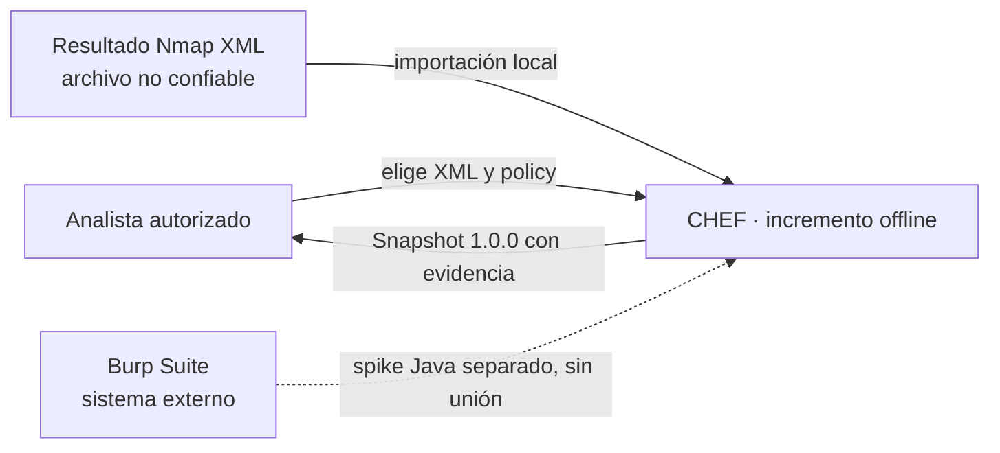
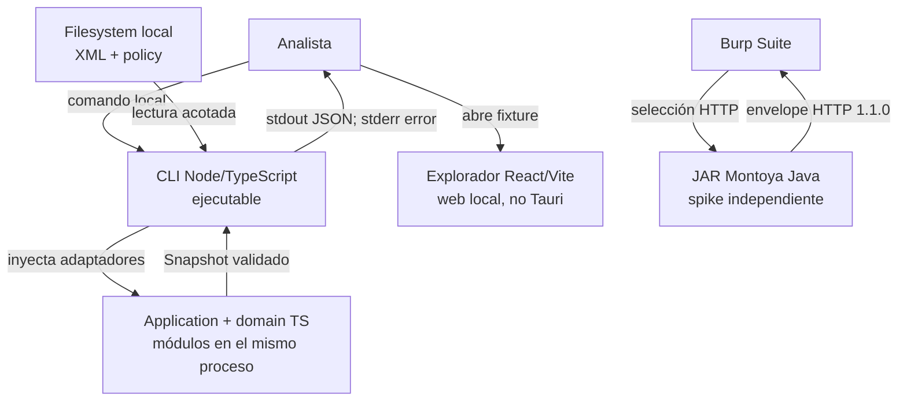
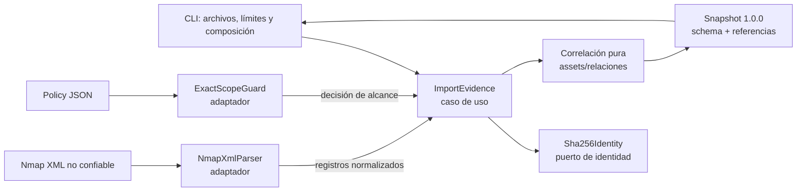

# Arquitectura de CHEF: estado actual y destino propuesto

Actualizado 18-10-2026. Este documento describe **lo que existe**. La nueva meta de escritorio se describe en [desktop-tauri.md](desktop-tauri.md); la antigua [web propuesta](proposed-web.md) se conserva como antecedente. La separación evita que un diagrama futuro se interprete como entrega. El modelo [C4 oficial](https://c4model.com/diagrams) usa distintos niveles de zoom: contexto (personas/sistemas), contenedores (unidades ejecutables y almacenes) y componentes (responsabilidades dentro de un contenedor).

## Nivel 1 · Contexto del sistema actual

CHEF actual es un proceso local de análisis, no un servicio SaaS. El analista controla el archivo y una allowlist literal de IP/puerto/protocolo; el XML jamás amplía ese scope. No se hacen conexiones al objetivo ni consultas OSINT. El spike Burp se muestra punteado porque no forma parte del flujo de importación del núcleo. Las flechas nombran interacciones y las cajas describen quién las controla.

## Nivel 2 · Contenedores actuales

El core TypeScript es una agrupación lógica **dentro del proceso Node**, no un servidor separado. El JAR Java vive en el proceso Burp y comparte fixtures/contratos, no imports TypeScript. `apps/web` contiene el explorador React local; aún no es una ventana Tauri. `apps/api` no tiene servidor. PostgreSQL/Prisma y OAuth no existen en este incremento. Rust ya tiene importador Nmap, importador offline parcial de eventos JSONL de origen, coordinación Tokio y un adaptador inicial de snapshots para SurrealDB/RocksDB; Tauri, el grafo normalizado y los proveedores OSINT siguen pendientes. La [arquitectura de escritorio](desktop-tauri.md) distingue código comprobable de destino.

## Nivel 3 · Componentes del proceso Node

La dependencia de código va desde CLI/adaptadores a casos de uso y dominio; el dominio no importa filesystem, red, React, Prisma ni Montoya. `ImportEvidence` recibe parser, guard, identidad y reloj por interfaces estrechas. El parser produce registros; no decide propiedad de activos ni persiste. El guard decide scope; la correlación crea IDs deterministas y conserva cada observación. La CLI publica JSON solo después de validarlo: un error deja stderr y ningún snapshot parcial. [SOLID](solid.md) y `npm run check:architecture` verifican dirección de imports, pero una revisión humana sigue siendo necesaria para responsabilidades semánticas.

## Fronteras de confianza e invariantes

1. **Archivo→parser:** bytes/XML son no confiables. CLI limita tamaño; parser rechaza DTD/entidades externas, profundidad y estructuras no soportadas. [CWE-611](https://cwe.mitre.org/data/definitions/611.html) y [CWE-400](https://cwe.mitre.org/data/definitions/400.html) orientan los controles; los fixtures hostiles son prueba, no garantía universal.
2. **Policy→scope:** solo IP/puerto/protocolo literales aprobados; exclusiones prevalecen. Ni un hostname en XML ni un proveedor OSINT pueden crear scope. El guard falla cerrado.
3. **Observación→inferencia:** evidencia tiene digest/locator/run; una relación guarda las observaciones que la sostienen. Un hash identifica contenido, no autentica origen. Hostname compartido no fusiona hosts; un servicio abierto no implica vulnerabilidad. `observed` e `inferred` son distintas aserciones.
4. **Snapshot→consumidor:** esquema y versión se validan antes de exportar; cualquier lector externo futuro también debe comprobar referencias únicas y existentes. UI no debe ejecutar HTML ni navegar URLs del dato importado ([CWE-79](https://cwe.mitre.org/data/definitions/79.html)).
5. **Futuro escritorio/integraciones:** Tauri IPC, capabilities, filesystem local, base embebida y proveedores remotos son fronteras nuevas aún sin implementar. La [matriz CWE](../security/cwe-controls.md), el [modelo de amenazas](../security/threat-model.md) y la [arquitectura de escritorio](desktop-tauri.md) especifican los gates.

## Cualidades y decisiones pendientes

**Correctitud:** mismo input + policy + reloj fijo producen IDs estables; control negativo impide una fusión débil. **Auditabilidad:** toda relación puede recorrerse hasta observación y evidencia. **Disponibilidad:** límites de 2 MiB/10 000 registros/profundidad 32 según [amenazas](../security/threat-model.md); la cancelación síncrona tiene un límite conocido. **Migración:** el dominio TypeScript sigue como referencia hasta que Rust iguale los golden. La aplicación Tauri, IPC, grafo normalizado SurrealDB y motores de red aún están pendientes. No se habilitan llamadas externas por incluirlas en el diagrama.

Los [ADRs](../adr/README.md) registran decisiones y propuestas. El [ADR 0012](../adr/0012-escritorio-tauri-rust.md) describe el destino Tauri/Rust; su revisión del equipo sigue pendiente. El [modelo de amenazas](../security/threat-model.md) y [estándares](../governance/standards.md) completan los requisitos de calidad. El código, las pruebas y los contratos publicados prevalecen sobre un diagrama si discrepan.
