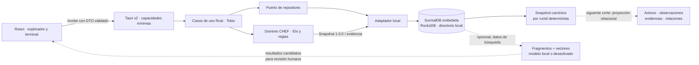
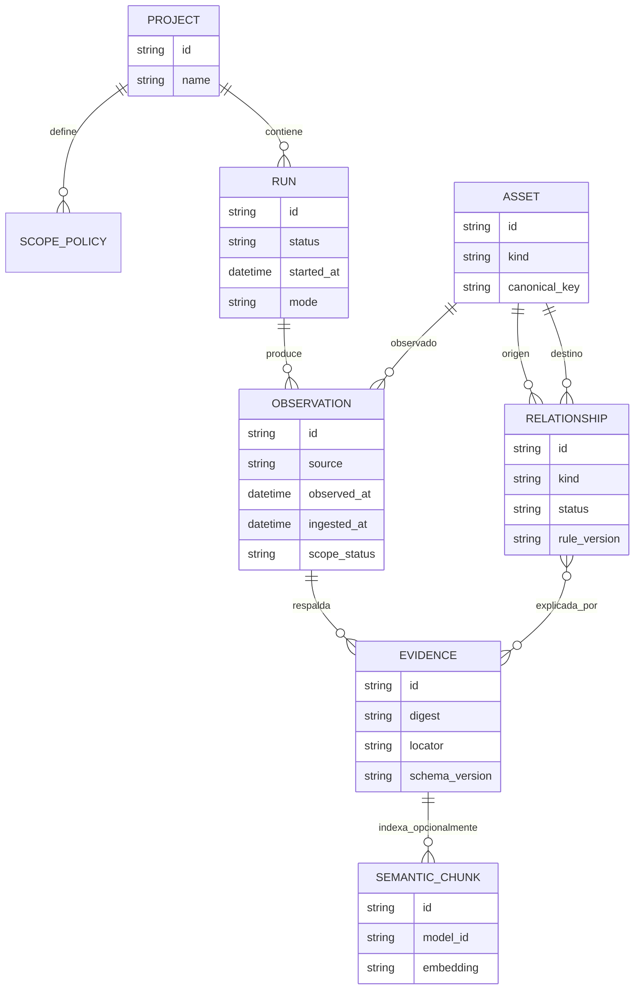

# Persistencia local, grafo y búsqueda semántica

Actualizado 18-10-2026. **Diseño en implementación parcial.** CHEF necesita conservar evidencia y relaciones con identidad estable en una aplicación de escritorio offline-first. El almacén debe funcionar dentro del proceso Rust, evitar un servicio local obligatorio y ofrecer consultas de grafo. La búsqueda vectorial es una ayuda opcional para encontrar evidencia parecida; no define identidad ni confirma una relación.

## Decisión vigente

Usar **SurrealDB embebida en Rust con RocksDB** como persistencia local y base del grafo CHEF. La interfaz consulta únicamente comandos Tauri; Rust abre una instancia por perfil, selecciona namespace/database y ejecuta consultas parametrizadas. El adaptador actual guarda el snapshot CHEF, los eventos de origen fuente y activos/evidencias/relaciones tipados en un registro con identidad determinista. La siguiente etapa puede materializar colecciones y relaciones para consultas de producto. El [SDK Rust](https://surrealdb.com/docs/reference/rust/embedding) ofrece motores embebidos; RocksDB aporta almacenamiento persistente y requiere dependencias nativas C++/libclang en el equipo de build.

El build de Windows necesita MSVC C++, NASM, CMake y libclang para las dependencias nativas de RocksDB. En el entorno CHEF se instalaron NASM 3.02, CMake 4.4.5 y libclang 18.1.1 en el perfil de usuario tras verificar sus SHA-256; `cargo check`, `cargo build --locked` y los bundles MSI/NSIS de `chef-storage` y Tauri pasan. Los artefactos se generan en `apps/desktop/src-tauri/target/release/bundle`; aún falta ejecutar y validar la persistencia desde la aplicación. El núcleo SurrealDB usa BSL 1.1 con un Additional Use Grant; el SDK tiene licencia separada. Revisar los avisos exactos de la versión incluida antes de distribuir. MongoDB local agrega un proceso/servidor; Atlas Local está orientado a desarrollo/pruebas y Search/Vector Search agrega servicios. [Licencia de SurrealDB](https://surrealdb.com/license), [opciones de despliegue vectorial MongoDB](https://www.mongodb.com/docs/vector-search/deployment/deployment-options/).

SurrealDB/RocksDB queda en spike y no se declara lista para producción. Antes del release se debe verificar en Windows/macOS/Linux: apertura exclusiva del directorio, escritura atómica, migraciones SurrealQL, backup/restauración, cierre inesperado, tamaño del instalador, actualización de versión y borrado del proyecto. Mantener la elección de SurrealDB; registrar los bloqueos concretos para resolver el build en cada plataforma.

## Componentes de persistencia

La UI no consulta la base directamente. Rust aplica proyecto, scope, validación, límites y transacciones antes de exponer DTO. La implementación actual guarda un documento canónico por `runId`; la normalización del grafo es una historia posterior. La conexión corre fuera del hilo UI. Los errores no se convierten en importaciones completas.

## Modelo de información CHEF

Las claves de producto siguen los IDs deterministas de CHEF, no IDs aleatorios asignados por la base. `Observation` conserva fuente, fechas, locator, scope y digest. `Relationship` diferencia vínculo observado, derivado o candidato y conserva la regla que lo explicó. Una relación candidata no se promociona por similitud vectorial. Cada proyecto y `run` limita las consultas; una importación inválida no publica una parte del grafo.

El XML original y secretos no se guardan por defecto. Si el producto necesita conservar artefactos originales, la política debe definir cifrado, permisos del directorio, retención, borrado y backup; un hash permite comprobar igualdad de bytes, pero no demuestra quién produjo el archivo.

## Papel limitado de los vectores

La primera entrega puede omitir vectores por completo. El grafo estructurado, búsqueda textual y filtros por tipo/fecha/fuente cubren la revisión principal. Si los analistas necesitan encontrar descripciones o notas semánticamente parecidas, añadir fragmentos derivados de evidencia normalizada y un vector con estos metadatos: `model_id`, versión, dimensión, fecha de generación, digest del texto de entrada y procedencia.

La búsqueda vectorial dentro de SurrealDB queda como evolución posterior. Primero se completa el grafo y la búsqueda textual sobre fragmentos con procedencia. Solo añadir embeddings e índice cuando un corpus/benchmark de CHEF muestre valor; el resultado será candidato explicable y nunca creará activos, fusionará hosts, ampliará scope o cambiará severidad.

La generación de embeddings no forma parte del importador ni se conecta a un proveedor remoto por defecto. Si se habilita, se usa un modelo local fijado y se registra su versión; si el modelo no está instalado, la búsqueda semántica se declara no disponible y las funciones de evidencia siguen operando.

## Comparación para el escritorio

| Alternativa                | Ajuste a CHEF                                                                                         | Coste/condición visible                                                                                                                                    | Decisión                                                                       |
| -------------------------- | ----------------------------------------------------------------------------------------------------- | ---------------------------------------------------------------------------------------------------------------------------------------------------------- | ------------------------------------------------------------------------------ |
| SurrealDB embebida/RocksDB | Documentos, grafo y vectores futuros en un motor; SDK Rust opera dentro de Tauri sin servidor.        | Seleccionada por el propietario; toolchain local (MSVC, NASM, CMake y libclang) ya permite `cargo check` en Windows; queda validar el bundle e instalador. | Elegida; completar el build reproducible y evaluar almacenamiento normalizado. |
| SQLite embebida            | Archivo local, transacciones y tablas para nodos/edges; CTE recursivas permiten recorridos del grafo. | No ofrece el mismo modelo de grafo/vector integrado; se conserva como alternativa comparada.                                                               | Descartada para CHEF por instrucción explícita del propietario.                |
| MongoDB local              | Buen almacén de documentos y búsqueda vectorial en despliegues compatibles.                           | No es una base embebida dentro de Tauri; Atlas Local usa CLI/Docker y Search/Vector Search agrega servicios/componentes.                                   | No recomendada para la primera instalación offline de escritorio.              |
| MongoDB Atlas remoto       | Adecuada para una futura edición multiusuario/centralizada, con Vector Search administrado.           | Requiere red, cuenta, costos, control de acceso y transmisión de datos del proyecto.                                                                       | Fuera del corte local offline; requiere ADR y consentimiento.                  |
| Motor vectorial separado   | Puede escalar similitud semántica especializada.                                                      | Suma proceso, puerto, índice, copia/backup y sincronización de IDs/evidencia.                                                                              | No añadir hasta medir una necesidad que la base principal no cubra.            |

Los detalles de motores embebidos y búsqueda varían por versión. Volver a consultar fuentes oficiales y actualizar esta comparación antes de fijar dependencias o afirmar soporte de producción.

## Pruebas para aceptar el spike

- Dado un fixture con IDs golden, cuando se persiste y se vuelve a abrir, los IDs, referencias, fechas y estados son idénticos.
- Dado un fallo entre escritura de observaciones y relaciones, cuando se reinicia, la importación aparece fallida o íntegra; nunca parcialmente completa.
- Dadas dos instancias que abren el mismo archivo, cuando la segunda intenta conectarse, el resultado es controlado y no corrompe el almacén.
- Dado un backup, cuando se restaura en un perfil temporal, el grafo y los digests se validan sin consultar red.
- Dada evidencia con descripciones similares, cuando se ejecuta la búsqueda vectorial, se muestran fuentes y puntuación como ayuda; el control negativo prueba que ningún resultado cambia relaciones o scope.
- Dado un proyecto nuevo sin modelo local, cuando se usa CHEF, importación, revisión y exportación siguen disponibles sin crear vectores ni transmitir datos.

Los tests de persistencia usan directorios temporales aislados y fixtures sintéticos. Registrar sistema operativo, versiones de Rust/SurrealDB/RocksDB, tamaño del corpus, RAM, latencias y método de recuperación; no presentar una medición aislada como garantía multiplataforma.
